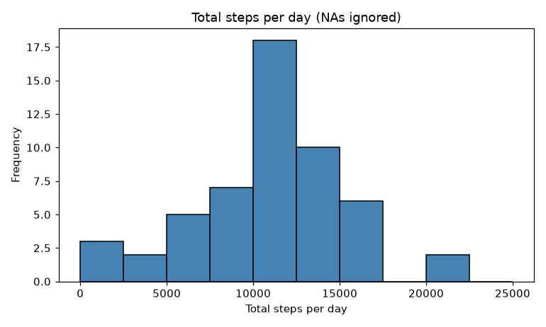
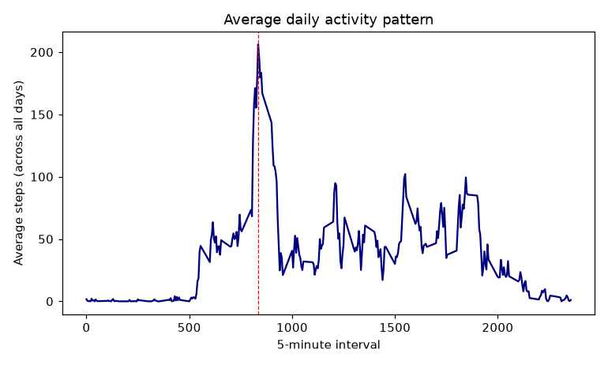
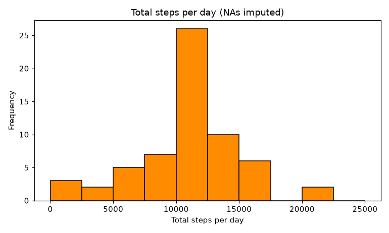
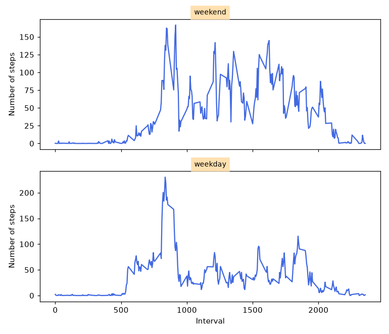

## Loading and preprocessing the data

The data come from `activity.zip` (included in this repository). Unzip it and read the CSV; the `date` column is converted to class `Date`.

```r
if (!file.exists("activity.csv")) unzip("activity.zip")
activity <- read.csv("activity.csv", stringsAsFactors = FALSE)
activity$date <- as.Date(activity$date, format = "%Y-%m-%d")
str(activity)
head(activity)
summary(activity)
```

```
## 'data.frame':	17568 obs. of  3 variables:
##  $ steps   : int  NA NA NA NA NA NA NA NA NA NA ...
##  $ date    : Date, format: "2012-10-01" "2012-10-01" ...
##  $ interval: int  0 5 10 15 20 25 30 35 40 45 ...

##   steps       date        interval
## 1    NA 2012-10-01        0
## 2    NA 2012-10-01        5
## 3    NA 2012-10-01       10
## 4    NA 2012-10-01       15
## 5    NA 2012-10-01       20
## 6    NA 2012-10-01       25

##      steps       
##  Min.   :  0.00  
##  1st Qu.:  0.00  
##  Median :  0.00  
##  Mean   : 37.38  
##  3rd Qu.: 12.00  
##  Max.   :806.00  
##  NA's   :2304
```

## What is mean total number of steps taken per day?

Missing values are ignored in this part (rows with `NA` are dropped, so the 8 days that are completely missing do not appear).

```r
daily <- aggregate(steps ~ date, data = activity, FUN = sum)   # total steps per day
hist(daily$steps, breaks = seq(0, 25000, by = 2500), col = "steelblue",
     main = "Total steps per day (NAs ignored)", xlab = "Total steps per day")
mean_steps   <- mean(daily$steps)
median_steps <- median(daily$steps)
mean_steps; median_steps
```

```
## [1] 10766.1887
## [1] 10765
```



## What is the average daily activity pattern?

Average the steps of every 5-minute interval across all days (NAs removed) and draw a time series.

```r
pattern <- aggregate(steps ~ interval, data = activity, FUN = mean)
plot(pattern$interval, pattern$steps, type = "l", col = "navy",
     xlab = "5-minute interval", ylab = "Average steps (across all days)",
     main = "Average daily activity pattern")
pattern[which.max(pattern$steps), ]
```

```
##     interval    steps
## 104      835 206.1698
```



## Imputing missing values

There are **2304** rows with `NA` in `steps` (all in 8 whole days). Strategy: replace every missing value with the **mean of its 5-minute interval** (across all days), then rebuild the histogram and the summary statistics.

```r
sum(is.na(activity$steps))           # total number of rows with NA

filled <- activity
idx <- is.na(filled$steps)
filled$steps[idx] <- pattern$steps[match(filled$interval[idx], pattern$interval)]
sum(is.na(filled$steps))

daily2 <- aggregate(steps ~ date, data = filled, FUN = sum)
hist(daily2$steps, breaks = seq(0, 25000, by = 2500), col = "darkorange",
     main = "Total steps per day (NAs imputed)", xlab = "Total steps per day")
mean(daily2$steps); median(daily2$steps)
```

```
## [1] 2304
## [1] 0
## [1] 10766.1887
## [1] 10766.1887
```



## Are there differences in activity patterns between weekdays and weekends?

Using the filled-in dataset, a factor `daytype` (weekday / weekend) is created from the date, then the interval means are computed per level and drawn as a two-panel lattice plot.

```r
library(lattice)
filled$daytype <- factor(ifelse(weekdays(filled$date, abbreviate = TRUE) %in% c("Sat", "Sun"),
                                "weekend", "weekday"))
pattern2 <- aggregate(steps ~ interval + daytype, data = filled, FUN = mean)
xyplot(steps ~ interval | daytype, data = pattern2, type = "l",
       layout = c(1, 2), xlab = "Interval", ylab = "Number of steps")
```



## Conclusions

* Ignoring missing values, the mean total of steps per day is **10766.19** and the median is **10765** (based on 53 complete days).
* On average, the interval with the most steps is **835** (08:35 in the morning) with **206.2** steps.
* After imputing the 2304 missing values with interval means the mean stays at **10766.19** and the median moves slightly from 10765 to **10766.19** (now equal to the mean). The 8 imputed days all take the average value, which adds 8 days to the centre bin of the histogram. Total daily steps are unchanged on average, but the number of days in the middle bin increases.
* Weekdays show a sharp morning peak (about 230 steps near interval 835) and little activity later; weekends are flatter and more spread through the day (peak 167 steps near interval 915). Mean steps per interval: 35.6 on weekdays and 42.4 on weekends, so the subject is more active on weekends.

*Report date: 2026-10-06. The numbers and figures were produced from `activity.csv` with an equivalent Python (pandas/matplotlib) pipeline that mirrors the R code; the R chunks above are the reproducible source (`PA1_template.Rmd`).*
